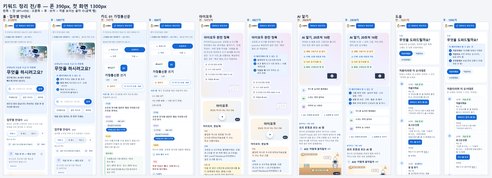

# 노안중 AI교육 운영 사이트

전남 나주 노안중학교(교육부 AI 중점학교) AI교육 코디네이터가 한 학기 동안 운영·기록·인수인계에 쓴 사이트.
빌드 도구 없는 순수 HTML/CSS/JS. **외부 요청 0건** — `file://` 로 열어도 그대로 돈다.

배포: <https://zln02.github.io/noan-ai/> — 첫 화면이 업무별 안내서다. QR 이 가리키는 곳.



<sub>폰 390px, 쪽마다 왼쪽이 전·오른쪽이 후. 숫자는 처음 보이는 글자 수(2026-11). 자세한 기록은 [`docs/ux/keyword-copy-2026-11.md`](docs/ux/keyword-copy-2026-11.md).</sub>

---

## 무엇을 푸는가

교사 12명, 코디네이터 1명, 한 학기. 문제는 도구가 없는 게 아니라 **있는데 안 쓰는 것**이었다.

| 문제 | 이 저장소의 답 |
|---|---|
| 교육청이 이미 준 도구를 찾기 어렵다 | 업무별 안내서 **25장** — 「무엇을 하시려고요?」로 열고, 도구는 카드 안의 한 줄 |
| 아이모두(교육청 AI 플랫폼)에 무엇이 있는지 아무도 모른다 | 교원 계정으로 46개를 하나씩 열어 본 **도구 사전** |
| 「토큰」「하네스」 같은 말이 연수를 막는다 | 20초짜리 움직이는 그림 **AI 알기** — 비유 → 진짜 → 다른 점 → 활용 |
| 연수가 끝나면 화면도 부탁 문장도 사라진다 | 회차별 안내 쪽 — 덱, 그날 쓴 부탁 복사 단추, 인쇄 안내지 |
| 결과보고서를 학기 끝에 몰아서 써야 한다 | 근무일마다 5분 기록이 그대로 보고서 원천이 되게 |
| 후임자에게 넘길 것이 사람 머릿속에만 있다 | `/ops/handover` 한 쪽 |

## 숫자로 보기

세어 볼 수 있는 것만 적었다. 기준은 main `fb9a0a4`(2026-11-20). 측정값에는 잰 날을 붙였다.

| 무엇 | 숫자 | 어디서 셌나 |
|---|---|---|
| 사이트 쪽 | HTML **25개** (수업 도구 `studio/`, 움직이는 그림 `terms/anim/` 제외) | 파일 수 |
| 업무별 안내서 | **25장** · 인쇄본 A4 가로 **28쪽** | `data/tasks.json` · `guide/노안중_AI안내서.pdf` |
| 아이모두 도구 사전 | 도구 **46개** · 화면 **49장** · 개인정보 가린 그림 **25장** (2026-11-20 캡처) | `data/iamodu-tools.json` · [개인정보 처리 기록](docs/ux/iamodu-privacy-log.md) |
| AI 알기 | 움직이는 그림 **12편** + 아이모두 1편 | `data/terms.json` |
| 공식 안내 판정 | 도구별 **12건** + 외부 연수 3건 | `data/guides.json` |
| 외부 요청 | **0건** (390·1440px, 2026-11) | [키워드 정리 기록](docs/ux/keyword-copy-2026-11.md) 「점검」 |
| axe serious·critical | **0** (390·1440px, 2026-11) | 같은 기록, axe-core |
| 확인한 화면 폭 | **8가지** — 320·360·375·390·768·1024·1366·1440px (2026-11) | 가독성·아이모두·전체 검토 기록 |
| 14px 미만 글씨 | 16쪽 합계 **435곳 → 39곳** (2026-11) | `tools/ux-readability.py` |
| 처음 보이는 글자 | 쪽마다 **11~27%** 줄임, 안내서 카드 25장 합 **−31%** (2026-11) | [키워드 정리 기록](docs/ux/keyword-copy-2026-11.md) |
| 서비스 워커 캐시 | **`noan-guide-v14`** | `sw.js` |
| 커밋 | **221개**, 그중 **180개**에 AI 공동 작성 표시 (2026-11-20) | `git log` |

## 설계 원칙

이 저장소에서 봐 주셨으면 하는 건 화면이 아니라 아래 일곱 가지다.

**외부 요청 0건.** CDN·웹폰트·트래킹이 없다. 아이콘은 SVG path 를 저장소에 넣어 쓰고,
라이브러리(Alpine·three.js·Web Awesome·Open Props 일부)는 `shared/vendor/` 에 라이선스와 함께 들어 있다.
학교 네트워크가 죽어도 연수가 진행된다. 이건 취향이 아니라 요구사항이었다 —
강당 와이파이를 믿고 슬라이드를 짤 수 없다. 2회차 덱이 3D 장면과 사진까지 품은 **한 파일 6.8MB** 인 것도 같은 이유다.

> **「외부 요청 0건」의 유일한 예외 — 선택 기능.** 핵심(안내서 카드 · 지시서 복사 · 연수 자료 · 오프라인 설치)은 지금도 앞으로도
> 외부 요청 없이 돈다. 「이 지시서 도움 됐어요」 같은 **선택 기능**만 Supabase 를 쓸 수 있고,
> `shared/config.js` 가 비어 있으면(기본값) 꺼져 있어 요청이 0건이다. 켜더라도 anon(공개) 키만 쓰고,
> 서비스 키는 저장소에 넣지 않으며, 이름·사진·성적은 보내지 않는다. 막히면 한 줄 안내만 보이고 안내서는 그대로 쓴다.
> 정책(RLS)은 `supabase/feedback.sql`, 정리는 [`docs/ux/ia.md`](docs/ux/ia.md).

**빌드 도구 없음.** npm run 이 없다. 후임자가 IDE 없이 메모장으로 글자를 고치고 저장하면 반영된다.
넘겨받을 사람이 개발자가 아니다. `tools/` 의 스크립트는 데이터를 다시 내보내거나 점검할 때만 쓰고,
돌리지 않아도 사이트는 열린다.

**데이터는 JSON 한 벌.** `Notion → tools/sync-notion.js → data/*.json → 페이지`.
토큰은 환경변수로만 읽는다. 저장소에도 브라우저에도 남기지 않는다.

**JSON 과 JS 를 짝으로 둔다.** 크롬은 `file://` 에서 `fetch` 를 막는다.
그래서 `tools/sync-data.js` 가 JSON 마다 `window.X_DATA` 를 담은 `.js` 를 만든다.
페이지는 `fetch` 를 먼저 쓰고 막히면 전역 변수로 넘어간다. USB 로 들고 가도 뜬다.

**개인정보 경계를 코드로 지킨다.** 사진·이름·성적은 `private/`(gitignore)와 노션에만.
sync 스크립트는 내보낼 필드를 **허용 목록**으로 못 박고, 본문에서 사람 이름 같은 문자열이
잡히면 **아무것도 쓰지 않고 멈춘다.** 사람의 주의력에 기대지 않는다.
화면 캡처도 같다. 원본은 저장소에 넣지 않고, 가린 사본만 올리고, 가린 곳의 *종류*만 기록에 남긴다.

**관객을 나눈다.** 선생님(`/`)과 운영(`/ops/`)이 다른 층이다.
선생님 내비에 「기록」은 없다. `/ops/` 는 링크로만 가고 `noindex` 다.

**폰에서 읽히는 것이 먼저다.** 선생님은 쉬는 시간에 폰으로 다시 본다. 그래서 본문 16px, 어떤 글도 14px 밑으로
내려가지 않고, 누르는 곳은 44px, PC 한 줄은 40em 안쪽이다. 이 규칙은 `shared/readability.css` 한 파일에 모아
각 쪽의 맨 마지막 스타일시트로 읽는다 — 기존 스타일을 고치지 않고 덮어써서 되돌리기 쉽다.
글도 같은 생각으로 줄였다. 쪽마다 맨 위에 **「이 페이지에서 할 수 있는 것」 세 줄**, 카드는 **무엇을 · 어디서 · 어떻게 · 주의**
네 칸, 긴 설명은 **「더 보기」** 안으로. 숫자·단추 이름·날짜는 하나도 바꾸지 않고 말만 덜어 냈다.
느낌으로 하지 않으려고 `tools/ux-readability.py` 로 18쪽 × 5폭을 재고 고친 뒤 다시 쟀다.

## 무엇이 들어 있나

| 쪽 | 내용 |
|---|---|
| **업무별 안내서** (`/`) | 25장. 카드마다 칩 한 줄(도구 · 시간 · 단계), 한눈에 네 칸, 지시서 복사, 근거와 **확인한 날**. 실제 화면 그림에는 **번호 동그라미**로 누를 곳을 찍고 그 아래 같은 번호의 목록을 붙였다. 그림 속 글씨가 폰에서 안 보이니 **「크게 보기」** 로 원래 크기를 펼친다 |
| **아이모두** (`/iamodu/`) | 들어가기 · 안에 무엇이 있나 · 막혔을 때 · **도구 사전 46개**. 2026-11-20 교원 계정으로 직접 들어가 찍은 화면으로 다시 만들었다. 이름이나 하고 싶은 일(수업 만들기·평가·자료 찾기·소통·업무)로 찾는다 |
| **AI 알기** (`/terms/`) | 움직이는 그림 12편 + 아이모두 1편 (교사에게 먼저 필요한 순서: 프롬프트·환각·개인정보·하네스). 눌러야 재생되고, 소리 없이 자막이 늘 나온다. 「모델」 대신 ChatGPT·Claude, 하네스는 「AI에게 도구와 레시피를 주는 것」 — 연수의 김치볶음밥 로봇과 같은 세계다. |
| **AI 활용 안내** · **AI는 어떻게 답을 만들까** (`/ai/` · `/how-ai-answers/`) | JNE GPT·Gemini·Claude·ChatGPT 네 가지를 확인한 날과 함께. 답이 만들어지는 과정을 3D로(안 되면 2D 그림으로) |
| **연수 자료** (`/training/`) | 1회차 「업무 편해지기」 2026-09-14 · 덱 18장. 2회차 「AI에게 무기를 주면」 **2026-11-23 14:00** · 덱 34장 |
| **2회차 안내** (`training/s2.html`) | **하네스란?**(유래와 실제 CC0 말 사진), **오늘 쓴 부탁 모음**(지시서 복사 단추 8개), 막히면, **인쇄 안내지 PDF**(A4 2쪽) |
| **2회차 덱** (`training/s2-deck-v2.html`) | 「먹과 놋쇠」 아트 디렉션. three.js 3D 장면, 하네스의 유래 장에 Bernard Spragg. NZ 의 CC0 사진 「Three horse power.」. 쓴 코드·글꼴·사진의 출처와 라이선스는 [`training/s2-deck-v2-NOTICE.md`](training/s2-deck-v2-NOTICE.md) |
| **설치·시작 가이드** (`/start/`) | 연수에서 한 그대로, ChatGPT·Claude에 교사 스튜디오를 세 걸음으로 |
| **수업 도구** (`/studio/`) | 수업에서 바로 쓰는 퀴즈·수학·독도 활동 등. 자기 서비스 워커로 따로 오프라인이 된다 |
| **운영 층** (`/ops/`) | 홈 · 기록 · 회차 · 인수인계. noindex |

## 어떻게 만들었나 — 교사 스튜디오와 AI

이 사이트는 운영자가 만든 오픈소스 하네스 **[교사 스튜디오(Teacher Studio)](https://github.com/zln02/teacher-studio)** 로 만들고 고쳐 왔다.
하네스는 AI에게 일하는 순서(레시피)와 도구를 챙겨 주는 틀이다. 2회차 연수에서 선생님들께 설치해 드린 바로 그것이다.

그래서 이 사이트는 하네스의 **실제 시험장**이기도 하다. 고치는 순서는 늘 같았다.
선생님이나 운영자가 흐릿하게 말한다 — 「가독성 확인 좀 해봐」, 「글이 너무 많지 않게」.
그 말을 **진단**으로 바꾸고, 고치고, **숫자로 다시 잰다.** 잰 기록은 지우지 않고 `docs/` 에 남긴다.

- **가독성 측정.** 「가독성 확인 좀 해봐」 → `tools/ux-readability.py` 로 글자 크기·줄 간격·한 줄 글자 수·대비·누르는 곳을 18쪽 × 5폭에서 잼 → 본문 14~15px이 원인으로 나옴 → 16px, 14px 미만 435곳 → 39곳. [`docs/ux/readability-2026-11.md`](docs/ux/readability-2026-11.md)
- **키워드 정리.** 「텍스트를 키워드별로」 → 처음 보이는 글자를 쪽마다 세고, 사실은 그대로 둔 채 말만 덜어 냄. [`docs/ux/keyword-copy-2026-11.md`](docs/ux/keyword-copy-2026-11.md)
- **개인정보 가리기.** 아이모두 캡처 114장을 검토 에이전트 넷이 나눠 한 장씩 보고 가릴 곳을 정함 → 단색으로 덮은 사본 생성 → 올린 사본을 **다른 에이전트가 다시** 한 장씩 확인(남은 개인정보 0) → 애매한 1곳을 더 가림. [`docs/ux/iamodu-privacy-log.md`](docs/ux/iamodu-privacy-log.md)
- **하네스 마찰 기록.** 하네스를 「사용자의 AI처럼 그대로」 따라 AI 말 복습 퀴즈를 만들어 보고, 막힌 곳 15개를 심각도와 고칠 위치까지 적음(폰 세로에서 글자 약 5px인데 검사는 PASS 등). 이 기록은 사이트가 아니라 하네스를 고치는 데 쓴다. [`docs/harness-testbed/2026-11-ai-quiz.md`](docs/harness-testbed/2026-11-ai-quiz.md)
- **검토 패스.** 다른 모델(Fable)이 처음 온 선생님의 길을 따라가며 순위를 매겨 비평하고, Opus가 결정과 최종 검토를 맡았다. 비평이 「합치지 말라」고 하면 합치지 않았다 — 위 퀴즈가 그렇다. [`docs/ux/fable-review.md`](docs/ux/fable-review.md)

**AI 도움에 대해 솔직히 적는다.** 이 저장소의 코드와 글 상당 부분은 운영자의 지시와 검토 아래 AI 에이전트(Claude)가 만들었다.
커밋 221개 중 180개에 AI 공동 작성 표시가 남아 있다. 무엇을 만들지, 무엇을 버릴지, 무엇이 사실인지는 사람이 정했다 —
학교에서 실제로 쓰는 화면을 직접 열어 확인하고, 선생님들 반응을 듣고, 결과물을 하나씩 봤다.
큰 갈림길의 이유는 [`docs/decisions.md`](docs/decisions.md) 에 날짜와 함께 있다.

## 구조

```
noan-ai/
├── index.html                  ★ 첫 화면 = 업무별 AI 안내서 25장 (JS 없이도 보이는 정적 목록 포함)
├── guide/                      목록(home-alpine.js·찾기·찜) · 상세(home.js) · 인쇄본 PDF · 옛 주소 넘김
├── iamodu/                     아이모두 완전 정복 + 도구 사전(dict.js)
├── terms/                      AI 알기 — 카드 쪽 + anim/ 움직이는 그림 17편
├── ai/  how-ai-answers/        AI 활용 안내 · AI는 어떻게 답을 만들까(3D, scene3d.js)
├── training/                   연수 자료 — index.html · s1.html(1회차 덱 18장) · s2.html(2회차 안내)
│                                 · s2-deck-v2.html(2회차 덱 34장, 한 파일 6.8MB, sw.js 미리 담기 제외)
│                                 · s2-deck-v2-NOTICE.md · assets/s2/(handout.pdf · horse.jpg)
├── start/                      설치·시작 가이드 (교사 스튜디오 세 걸음)
├── studio/                     수업 도구 (자기 sw.js·manifest)
├── library/  about/  class/  contest/  showcase/
├── ops/                        운영 층 — 홈 · log/ · sessions/ · handover/
├── sw.js  manifest.webmanifest  offline.html  404.html   「홈 화면에 추가」 + 오프라인
├── data/                       ★ 모든 데이터가 여기 한 곳 (JSON 마다 .js 짝)
│   ├── tasks.json          안내서 25장의 원본 (인쇄본과 같은 원천)
│   ├── iamodu-tools.json   아이모두 도구 사전 46개
│   ├── terms.json          AI 알기 글 (그림·자막의 원천)
│   ├── ai-models.json      AI 활용 안내 네 가지
│   ├── guides.json         도구별 공식 안내 판정 12건 + 외부 연수 3건
│   ├── schedule.json  sessions.json   연수 일정 · 회차별 기록
│   ├── log.json                       활동 기록 (노션에서 내려받음)
│   └── approval.json  quicktasks.json  contest.json  showcase.json
├── shared/   tokens.css  site.css  portal.css  portal-pages.css  premium.css  app.css  readability.css(가독성 층)
│             app.js(탭바·오프라인)  site.js  motion.js  zoom.js(크게 보기)  dial.js  icons.js  config.js  feedback.js
│             deck.css  deck.js  deck-stage.js  contest.js
│             vendor/ alpine · three · webawesome · open-props (라이선스 동봉)
├── assets/   guide/(안내서 화면)  iamodu/(도구 사전 화면, 가린 사본)  terms/(썸네일)  qr-*.svg  아이콘
├── tools/    sync-notion.js  sync-data.js  gen-home-static.js  gen-terms.js  shoot-terms.py
│             guide-build.py  check-copy.js  test-portal.js
│             ux-audit.py  ux-axe-detail.py  ux-offline-check.py  ux-readability.py  ux-contact.py  CONTRACT.md  …
├── supabase/ feedback.sql  migrations/  functions/   (선택 기능, 기본은 꺼짐)
├── docs/     decisions.md  handover.md  ux/(진단·측정·전후 그림)  harness-testbed/  content/  cli/  shots/  …
├── private/  (gitignore) 학교 실물 자료
└── README.md  LICENSE
```

## 데이터 흐름

```
  ┌─────────┐   sync-notion.js    ┌──────────────┐   sync-data.js   ┌──────────────┐
  │ Notion  │ ──────────────────▶ │ data/*.json  │ ───────────────▶ │ data/*.js    │
  │ (원천)  │   토큰=환경변수      │  (원본)      │  file:// 폴백    │ window.X_DATA│
  └─────────┘   이름 잡히면 정지   └──────────────┘                  └──────────────┘
                                     │      │                               │
                     guide-build.py  │      └──────────────┬────────────────┘
                     gen-terms.js    ▼                     ▼
                       인쇄본 PDF · 움직이는 그림    페이지: fetch 먼저, 막히면 전역 변수
```

인쇄본도 같은 원천에서 나온다. `tools/guide-build.py` 가 `data/tasks.json` 하나로
A4 가로 28쪽 PDF 를 만든다. 화면과 종이의 문장이 갈라지지 않도록 같은 데이터를 사용한다.
AI 알기도 같다. `tools/gen-terms.js` 가 `data/terms.json` 의 글로 `terms/anim/*.html` 을 만든다.

## 로컬에서 보기

`index.html` 을 더블클릭한다. 끝이다. 서버도 설치도 필요 없다.

## 갱신하기

```bash
# 1. 노션에 적는다 (활동 기록 · 도구 승인 현황)
# 2. 내려받는다
NOTION_TOKEN=... NOTION_LOG_DB=... node tools/sync-notion.js
# 3. file:// 폴백 짝을 다시 만든다 (푸터의 「최종 수정」도 오늘 날짜로 찍힌다)
node tools/sync-data.js
# 4. 커밋
```

안내서나 데이터의 문장을 만졌다면:

```bash
node tools/sync-data.js --check     # JSON·JS 짝과 첫 화면 「정적 목록」(JS 없이 보이는 25장)이 맞는지
node --test tools/test-portal.js    # 포털 구조 검사
node tools/check-copy.js            # 1회차 대본이 덱에 남아 있는지
```

정직하게 적어 둔다. `test-portal.js` 는 5개 중 3개가 통과하고, 2개(공유 스타일 검사 · `'#' + t.no` 주소 검사)는
예전부터 실패하던 그대로다. `check-copy.js` 는 24장 시절 대본을 기준으로 해서, 18장으로 줄인 지금 덱에서는
빠진 문장을 보고한다. 둘 다 새로 생긴 실패가 아니다(2026-11-20 확인).

## 화면을 고칠 때

[`docs/ux/`](docs/ux/) 에 진단·고객 여정·정보 구조·측정 기록·전후 그림이 있다.
페이지를 추가하면 `sw.js` 의 `CORE` 목록에 넣고 `CACHE_VERSION` 숫자를 올린다(지금 `noan-guide-v14`).
큰 파일(2회차 덱, 도구 사전 그림 49장)은 일부러 미리 담지 않는다 — 한 번 열어 본 것만 담긴다.

```bash
python tools/ux-audit.py docs/ux/after http           # 콘솔 오류 · 외부 요청 · axe
python tools/ux-offline-check.py                      # 한 번 열고 인터넷을 끊어도 열리는지
PYTHONUTF8=1 py tools/ux-readability.py <출력 폴더>   # 글자 크기 · 줄 길이 · 대비 · 누르는 곳
```

## 결과

*2026-12 결과보고서 작성 시 손으로 채운다. 자동 집계하지 않는다 — 숫자를 자랑하려고
만든 사이트가 아니라 일을 줄이려고 만든 사이트다.*

- 연수 __회 · 참석 __명
- 업무별 안내서 25장 (인쇄본 A4 가로 28쪽)
- 아이모두 도구 사전 46개
- 도구별 공식 안내 판정 12건
- 활동 기록 __건

## 인수인계

[`/ops/handover`](ops/handover/index.html) — 이 자리가 하는 일, 연간 흐름, 계정 발급 절차,
파일 위치, 첫날 할 일 5개, 미해결 목록.
큰 결정의 이유는 [`docs/decisions.md`](docs/decisions.md) 에 날짜와 함께 적어 두었다.
요청하기(`request/`) 쪽과 요청 게시판은 2026-11 에 없앴다. 막혔을 때 보는 곳은 `start/index.html#stuck`
(자주 막히는 8가지 · 아이모두 처음 순서 7단계)이다.
아이모두 화면이 바뀌면 [`docs/ux/iamodu-manual-update.md`](docs/ux/iamodu-manual-update.md) 의 「남은 일」부터 본다.

## 라이선스

코드는 MIT ([LICENSE](LICENSE)). 함께 넣은 라이브러리는 `shared/vendor/` 각 폴더의 LICENSE,
2회차 덱에 들어간 코드·글꼴·CC0 자산은 [`training/s2-deck-v2-NOTICE.md`](training/s2-deck-v2-NOTICE.md) 를 따른다.
학교 로고·교표는 **노안중학교 소유이며 재사용을 허락하지 않는다**
(`assets/logo.png`). 저장소를 참고하실 때 그 파일들은 빼고 보시면 된다.

---

## In English

A public-school operations site built by a single AI-education coordinator at Noan Middle School
(Naju, Jeonnam, Korea) over one semester. Plain HTML/CSS/JS — **no build step, no CDN, no
tracking, zero external requests** — because the school's Wi-Fi cannot be trusted during a
teacher-training session, and the person inheriting this repository is not a developer.

Four things are worth a look. **The privacy boundary is enforced in code, not in a policy
document**: the Notion sync ships an allow-list of exportable fields and halts the whole
export when a string that looks like a student's name appears in the body text; screenshots
are masked, re-checked by a second agent, and logged by *kind* of data only.
**Every JSON file has a generated JS twin** (`window.X_DATA`) so that pages still render from a
USB stick when Chrome blocks `fetch` on `file://`. **The same JSON produces both the web
guide and the printed A4 booklet**, so screen and paper cannot drift apart. And **readability
is measured, not guessed**: a 16px body, a 14px floor, 44px tap targets and ~40em lines, checked
with a script across 18 pages and 5 viewport widths.

The site was built and maintained with the author's open-source agent harness,
[Teacher Studio](https://github.com/zln02/teacher-studio), and doubles as its live test bed:
vague feedback goes in, and comes out as a diagnosis, a fix and a re-measurement, all logged in `docs/`.
Much of the code and copy was produced by AI agents (Claude) under the author's direction and
review — 180 of 221 commits carry an AI co-author trailer. Decisions about what to build, what
to cut and what is true were made by a person, against the real school systems. Those decisions
and their reasons are logged in `docs/decisions.md`.

The site is split into two audiences: teachers at `/`, operations at `/ops/` (noindex, linked
from nowhere).
