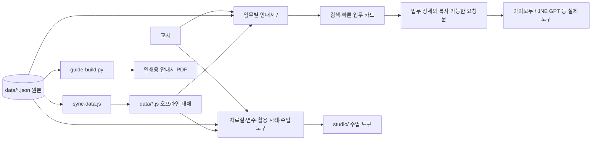
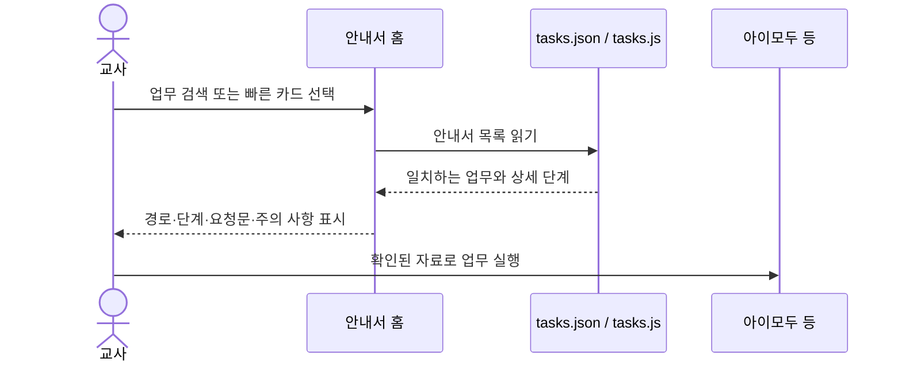

# 노안중 AI교육 포털 구조

## 데이터와 게시 흐름

- `data/tasks.json`이 업무 안내서의 원본이다. 번호와 ID가 유일하고, 제목·상황·검색어·단계·요청문·주의 사항을 담는다.
- `data/quicktasks.json`은 첫 화면 바로가기다. 각 `no`는 업무 안내서 번호와 연결한다.
- `data/showcase.json`은 동의를 확인한 학생 작품만 다룬다. 실제 개발된 수업 도구는 활용 사례에서 별도 섹션으로 소개한다.
- `tools/sync-data.js`는 `file://`에서도 읽을 수 있도록 JSON과 같은 내용의 JS 대체 파일을 만든다.
- `tools/guide-build.py`는 같은 업무 원본으로 인쇄용 HTML을 만든다. PDF는 이 HTML을 A4 가로로 인쇄한다.
- `tools/test-portal.js`는 업무 데이터, 캡처 파일, 바로가기, 도구 링크, 동의 필터와 공통 스타일 연결을 검사한다.

## 화면 동작

## 확인 명령

`node tools/sync-data.js --check` · `node --test tools/test-portal.js` · `git diff --check`

학생 작품·연수 일정·학교 실적은 실제 기록과 공개 동의를 확인한 뒤에만 추가한다. 업무 요청문은 초안이며 날짜·담당·성취기준·평가 규정은 교사가 원본에서 확인한다.
